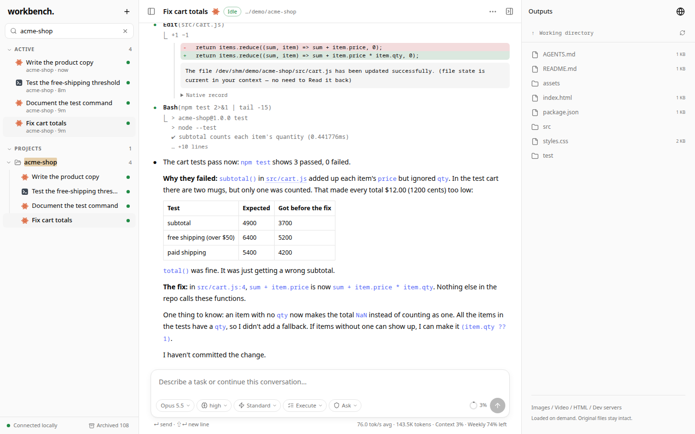
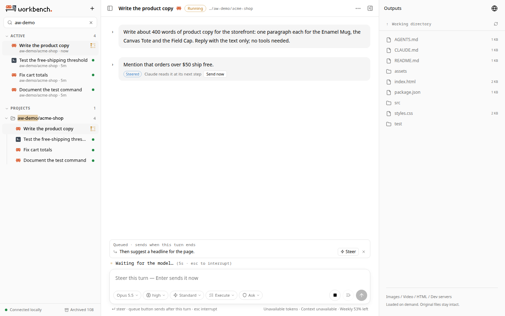
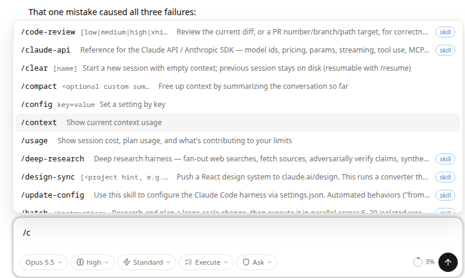
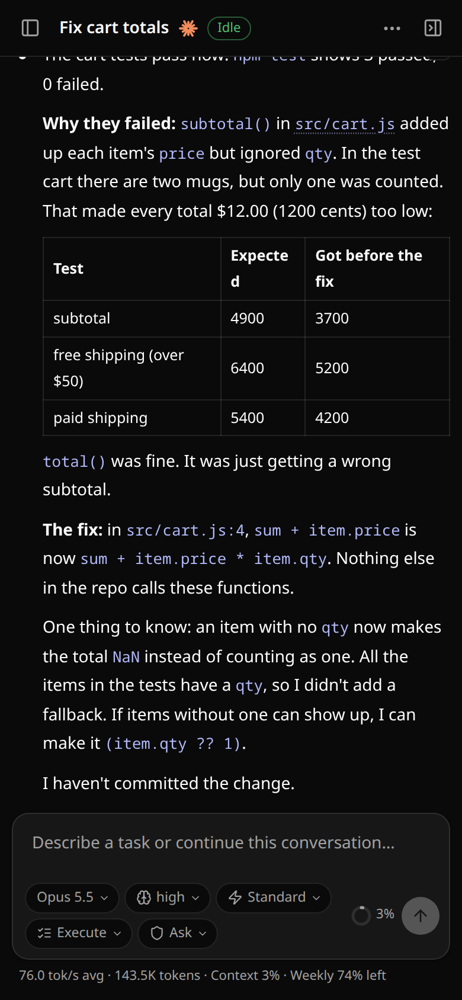

# Agent Workbench

A local-first web workbench for the Claude Code and Codex CLIs you already use.

[](https://github.com/winkidney/agent-workbench/actions/workflows/ci.yml)
[](LICENSE)
[](https://github.com/winkidney/agent-workbench/releases)

<picture>
  <source media="(prefers-color-scheme: dark)" srcset="docs/screenshots/hero-dark.png">
  
</picture>

Agent Workbench runs on your machine next to `claude` and `codex` and gives both a browser interface. It drives the official CLIs through their own protocols (Claude Code's stream-json mode and the Codex app-server), so your logins, settings, MCP servers, skills and project rules keep working, and every conversation stays in the CLI's own records. Open it from a browser on the machine, or, once you set up a pairing code or a password, from any device on your network, including a phone.

## Features

**Every session in one place**
- All Claude Code and Codex sessions on the machine, grouped by the project they were started in, with subagent sessions nested under their parent.
- Search, pins, a live "Active" list, and archived or hidden sessions out of the way.
- Sessions are the CLIs' own: continue one here or in a terminal (`claude --resume`, `codex resume`). A session another client is running is followed live, read-only.
- Choose each agent's program and home folder in Settings (a pinned CLI version, a separate account), and sign a CLI in from the page, from any device.

**Live control**
- Replies, thinking and tool calls stream in and look like each CLI's terminal UI: its colors, diffs and ANSI output.
- Mermaid diagrams in replies and plans are drawn in the theme's colors, with their source a click away.
- Paste screenshots into the prompt, or drop or pick images and files of any kind: the agent sees the images, and reads the files where the workbench keeps them.
- Press Enter during a turn to **steer** it: Codex takes the message at its next step (`turn/steer`); Claude takes it in at its next step, as its own TUI does, with **Send now** when you can't wait.
- Queue follow-ups for after the turn, interrupt with Esc, and answer approvals and questions from the keyboard.
- After a Claude turn, the prompt suggests what you would likely type next, as Claude Code's terminal does; Tab fills it in.
- Model, effort, speed, plan mode and permissions per session, shown as pills that always show the value in effect. New sessions start with each CLI's automatic approvals (Claude Code's Auto mode, Codex's Auto-review).
- Sessions waiting for an approval, a question or a plan decision stand out in the sidebar, count in the tab title, and can send a desktop notification.
- Cards for Codex's requests for more access and for MCP servers' forms; lines for what the CLIs only told their terminals (auto-mode blocks, warnings, model switches, failed hooks), and one Changes row per Codex turn.
- Background work (Claude's background shells, monitors and subagents, Codex's background terminals) shows in the sidebar and in a tray above the composer, with its output and a Stop button; Ctrl+B moves a long Claude command to the background.
- Subagents (Claude and Codex) show as one row with the tools they run under it, the same live and after a reload, and link to their own transcripts; their permission requests say which subagent asks.

**Commands and skills**
- `/` commands and `$` skills with completion: Claude Code's own commands, and the Codex TUI commands that make sense outside a terminal (`/compact`, `/review`, `/goal`, `/fork`, `/mcp`, `/diff`, …).
- `/goal` for both agents, with a goal bar above the composer: status, time and tokens, and pause, resume, edit and stop.
- `/plan` and `/default` switch plan mode in both agents.

**Files and previews**
- Paths in replies open the file, resolved from where the agent was when it wrote them.
- Images and videos open in a zoomable viewer; HTML, PDF, SVG and local dev servers open in an isolated preview panel.
- Show any file in your desktop file manager, or, from another device, download it (a folder as a zip).

**Status and usage**
- A turn clock, live tokens per second, context usage and the provider's quota windows.

**Anywhere on your network**
- Use it from your phone or another computer once you choose, in Settings, how other devices sign in: a pairing code, or a username and password. Settings shows how the page you are on is connected, lists signed-in devices (and signs out the others), and has an About tab with the versions of the workbench and both CLIs and a diagnostics summary.
- Layouts for desktop and phone.

**Themes**
- Light, dark or system mode, with any of ten color themes: Default (each CLI's own colors), Everforest, Gruvbox, Solarized, Paper (sepia), Catppuccin, Rosé Pine, Nord, Tokyo Night and Darcula (JetBrains' Darcula and IntelliJ Light). A theme colors the interface, code highlighting and terminal output alike.

**Packaged for macOS, Windows and Linux**
- One binary. `agent-workbench install` starts it at login (systemd user unit, launchd agent or Run key).
- Run more than one workbench side by side, each with its own data directory, address and settings ([details](docs/install.md#more-than-one-workbench)).

| Steering a running turn | Commands | Phone |
| --- | --- | --- |
|  |  |  |

## Quick start

**Requirements:** the [Claude Code](https://docs.anthropic.com/en/docs/claude-code) CLI and/or the [Codex](https://github.com/openai/codex) CLI, installed and logged in. On Windows, Claude Code also needs Git for Windows.

**Install a release.** Download the archive for your platform from [Releases](https://github.com/winkidney/agent-workbench/releases), unpack it, and run `install`:

```sh
# Linux (or use the .deb / .rpm package, then run `agent-workbench install` as yourself)
tar -xzf agent-workbench_*_linux_amd64.tar.gz
./agent-workbench install

# macOS (universal binary; the builds are not signed yet)
tar -xzf agent-workbench_*_macos_universal.tar.gz
xattr -dr com.apple.quarantine agent-workbench
./agent-workbench install
```

```powershell
# Windows (PowerShell, in the unpacked folder)
.\agent-workbench.exe install
```

Then open **http://agent.localhost:17880**. `install` copies the binary to your user's program folder, starts the workbench now and at every login; run it again with a newer release to upgrade. See [docs/install.md](docs/install.md) for details, uninstalling and platform notes.

**Build from source** (Go 1.24+, Node.js 22+):

```sh
git clone https://github.com/winkidney/agent-workbench.git
cd agent-workbench
make build
./bin/agent-workbench start      # or: ./bin/agent-workbench install
```

**First steps**
- Pick a session in the sidebar, or press **+** to start one: choose Claude or Codex, a project folder, and type the first message.
- During a turn, Enter steers and the queue button keeps a message for after the turn; Esc interrupts.
- Type `/` for commands, `$` for skills. Click a path in a reply to open it.

More in [docs/usage.md](docs/usage.md).

## Command line

```text
agent-workbench start       start in the background (default)
agent-workbench stop        stop (ends managed sessions and previews)
agent-workbench status      whether it runs, where, and the login start
agent-workbench install     copy the binary, start at login, start now (also upgrades)
agent-workbench uninstall   remove the login start (--purge also deletes data)
agent-workbench serve       run in the foreground
agent-workbench doctor      check claude, codex and the platform
agent-workbench version
```

| Flag | Default | Meaning |
| --- | --- | --- |
| `--listen HOST:PORT` | `0.0.0.0:17880` | Listen address; `127.0.0.1:17880` keeps it to this machine. |
| `--data-dir PATH` | per OS, see below | Private state: the session index, settings, event cache. |
| `--idle DURATION` | `5m` | Put an idle engine to sleep after this long. |
| `--env NAME` | | `install` only: also pass this environment variable to the service. |

A second workbench takes its own `--data-dir` and `--listen`; it is named after its port, and later commands find it from `--data-dir` alone (see [More than one workbench](docs/install.md#more-than-one-workbench)).

Data lives in `~/.local/state/agent-workbench` on Linux (or `$XDG_STATE_HOME`), `~/Library/Application Support/agent-workbench` on macOS, and `%LOCALAPPDATA%\agent-workbench` on Windows. Conversations themselves stay in the CLIs' records (`~/.claude`, `~/.codex`, or `CLAUDE_CONFIG_DIR` / `CODEX_HOME`).

## Security

The workbench can run agents that read and change files and run commands as you, so treat access to it like access to your shell.

- It never reads the CLIs' credential files and never writes their conversation records; approvals and permissions are the CLIs' own.
- It answers on all interfaces, but only this computer (`localhost`, `127.0.0.1`) uses it without signing in. Other devices are refused until you choose in Settings how they sign in: a pairing code, or a username and password in the browser's own prompt. Unknown domain names pointed at your machine (DNS rebinding) are other devices too.
- Changes must come from a page on the same origin. Previews run on separate `p-*.agent.localhost` origins and never receive the workbench's cookies.
- It is not meant to be exposed to the internet directly.

See [SECURITY.md](SECURITY.md) to report a vulnerability, and [docs/architecture.md](docs/architecture.md#security-model) for the full model.

## How it works

A Go server runs each agent's CLI as a child process (on Linux under systemd, each one as its own unit) and talks to it over stdin and stdout: Claude Code with `-p --input-format stream-json --output-format stream-json`, Codex with `codex app-server`. History is read from the CLIs' records, and a small SQLite database keeps the session index and a short event cache. The React interface is embedded in the binary and receives live updates over server-sent events. Details are in [docs/architecture.md](docs/architecture.md).

Tested with Claude Code 2.1.322 and Codex 0.167.

## Documentation

- [Installing, upgrading and uninstalling](docs/install.md)
- [Using the workbench](docs/usage.md)
- [Architecture, API and security model](docs/architecture.md)
- [Contributing](CONTRIBUTING.md) and [verification notes](docs/verification.md)

## License

[MIT](LICENSE)
