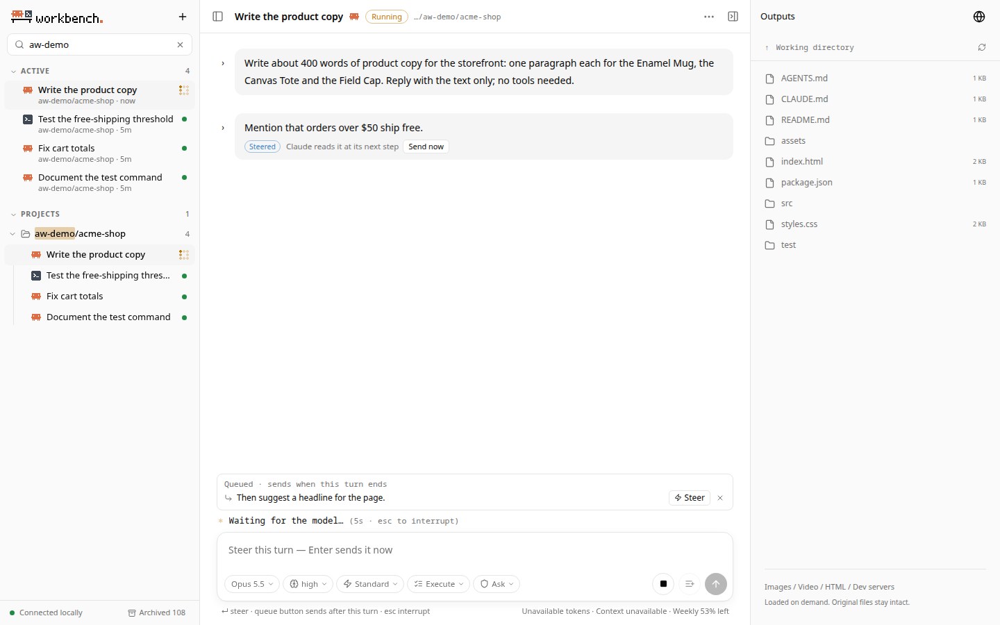

# Agent Workbench

A local-first web workbench for the Claude Code and Codex CLIs you already use.

[](https://github.com/winkidney/agent-workbench/actions/workflows/ci.yml)
[](LICENSE)
[](https://github.com/winkidney/agent-workbench/releases)

<picture>
  <source media="(prefers-color-scheme: dark)" srcset="docs/screenshots/hero-dark.png">
  
</picture>

Agent Workbench runs on your machine next to `claude` and `codex` and gives both a browser interface. It drives the official CLIs through their own protocols, so your logins, settings, MCP servers, skills and project rules keep working, and every conversation stays in the CLI's own records. Use it from this computer, or sign in from your phone or another device.

## Highlights

- **Your CLIs, not a replacement.** Every Claude Code and Codex session on the machine, grouped by project. Continue any of them here or in a terminal.
- **Many agents at a glance.** See which session is working, which one waits for you, and what each changed. Approvals and questions arrive as cards, with desktop notifications.
- **Full control of a turn.** Steer it while it runs, queue follow-ups, interrupt; choose model, effort, plan mode and permissions per session; `/goal`, side chats, background tasks in a tray.
- **Moss and your assistants.** Moss is a personal assistant that carries on day to day and keeps a wiki from your conversations. Ask it to set up assistants for recurring jobs; each is a folder in a git repository, and every change it makes in the background is a commit you can undo.
- **Routines.** Send a session a message, run a command, or hand a command's output to an agent: once, daily, every so often, or on a cron schedule. Agents can schedule their own follow-ups.
- **Files, previews and a terminal.** Paths in replies open as images, HTML, PDF, Markdown or text; mark up screenshots; preview dev servers; open a shell in the session's folder.
- **From anywhere.** A phone layout, sign-in with a pairing code or password, and a stream light enough for mobile data (about 0.6 MB an hour on a quiet session).
- **Light on resources.** One Go binary that uses about 50 MiB of memory in daily use. Idle agents sleep after 5 minutes and resume the same conversation on the next message, so dozens of sessions cost no more than the few that are working.

| Steering a running turn | Commands | Phone |
| --- | --- | --- |
|  |  |  |

It is a single-user tool for your own machine, not a hosted service for a team.

## Quick start

**Requirements:** the [Claude Code](https://docs.anthropic.com/en/docs/claude-code) CLI and/or the [Codex](https://github.com/openai/codex) CLI, installed and logged in. On Windows, Claude Code also needs Git for Windows.

Download the archive for your platform from [Releases](https://github.com/winkidney/agent-workbench/releases), unpack it, and run `install` from your usual shell:

```sh
# Linux (or install the .deb / .rpm, then run `agent-workbench install` as yourself)
tar -xzf agent-workbench_*_linux_amd64.tar.gz
./agent-workbench install

# macOS (universal binary; the builds are not signed yet)
tar -xzf agent-workbench_*_macos_universal.tar.gz
xattr -dr com.apple.quarantine agent-workbench
./agent-workbench install
```

```powershell
# Windows (PowerShell, in the unpacked folder)
.\agent-workbench.exe install
```

Open **http://agent.localhost:17880**. `install` starts the workbench now and at every login, and records your `PATH` so it can find `claude` and `codex`. Run it again with a newer release to upgrade. See [docs/install.md](docs/install.md) for details and uninstalling.

**From source** (Go 1.24+, Node.js 22+): `make build`, then `./bin/agent-workbench install`.

**First steps:** pick a session in the sidebar or press **+** to start one. During a turn, Enter steers and Esc interrupts. Type `/` for commands and `$` for skills. To meet Moss, click **Moss · Set up** in the sidebar. More in [docs/usage.md](docs/usage.md).

## Command line

```text
agent-workbench install     start at login and now (also upgrades)
agent-workbench start|stop|status
agent-workbench uninstall   remove the login start (--purge also deletes data)
agent-workbench doctor      check claude, codex and the platform
agent-workbench routine     add, list or remove routines
agent-workbench assistant   send an assistant a message, make or reload assistants
```

Common flags: `--listen HOST:PORT` (default `0.0.0.0:17880`), `--data-dir PATH`, `--idle 5m`. A second workbench takes its own `--data-dir` and `--listen` ([details](docs/install.md#more-than-one-workbench)).

## Security

The workbench runs agents that read and change files and run commands as you, so treat access to it like access to your shell.

- Only this computer uses it without signing in. Other devices are refused until you choose a pairing code or a password in Settings.
- It never reads the CLIs' credentials or writes their records; approvals and permissions are the CLIs' own.
- It is not meant to be exposed to the internet directly.

See [SECURITY.md](SECURITY.md) and the [security model](docs/architecture.md#security-model).

## Documentation

- [Installing, upgrading and uninstalling](docs/install.md)
- [Using the workbench](docs/usage.md)
- [Architecture, API and security model](docs/architecture.md)
- [Contributing](CONTRIBUTING.md) and [verification notes](docs/verification.md)

Works with Claude Code 2.1.330 and Codex 0.170.

## License

[MIT](LICENSE)
