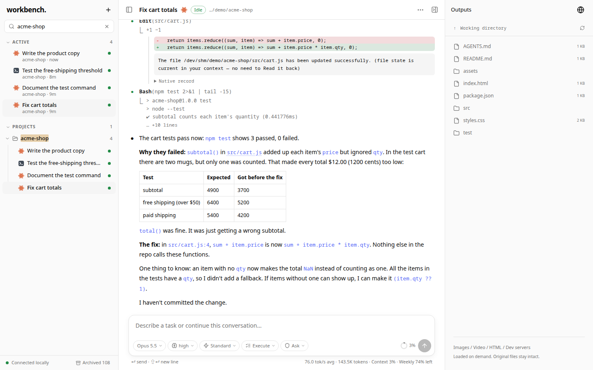
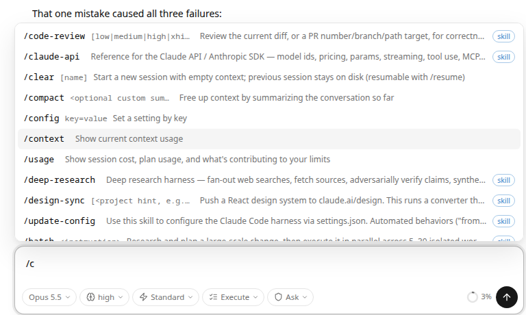
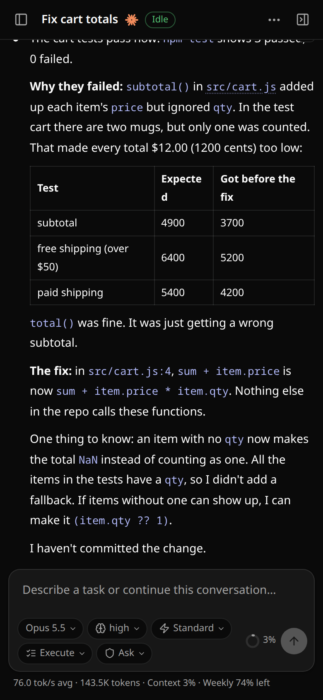

# Agent Workbench

A local-first web workbench for the Claude Code and Codex CLIs you already use.

[](https://github.com/winkidney/agent-workbench/actions/workflows/ci.yml)
[](LICENSE)
[](https://github.com/winkidney/agent-workbench/releases)

<picture>
  <source media="(prefers-color-scheme: dark)" srcset="docs/screenshots/hero-dark.png">
  
</picture>

Agent Workbench runs on your machine next to `claude` and `codex` and gives both a browser interface. It drives the official CLIs through their own protocols (Claude Code's stream-json mode and the Codex app-server), so your logins, settings, MCP servers, skills and project rules keep working, and every conversation stays in the CLI's own records. Open it from a browser on the machine, or, once you set up a pairing code or a password, from any device on your network, including a phone.

## Who it's for

- **You already use Claude Code or Codex in a terminal** and want a better view and better control, without switching tools: sessions stay the CLIs' own, and you can carry on in a terminal at any time.
- **You run several agents at once**, across projects, and need to see which one is working, which one waits for you, and what each changed.
- **You want to check in from your phone or another computer**: approve a step, answer a question, steer a turn, read a diff.
- **Your machine also has other work to do**: a laptop, a home server or a workstation that stays on for days, where idle agents shouldn't hold gigabytes of memory.

It is a single-user tool for your own machine, not a hosted service for a team.

## Light on memory and resources

- **Idle agents sleep.** Each agent CLI is a process of its own, from about 120 MiB at start to several hundred MiB in use. An engine idle for 5 minutes (`--idle`) is stopped, and the next message resumes the same conversation, so dozens of sessions cost no more than the few that are working. Work in progress keeps its engine awake: a turn, an approval, background shells and subagents, scheduled tasks, a goal.
- **A small server.** One Go binary with an embedded interface and a SQLite file: about 12 MiB at start and around 50 MiB in daily use with more than a thousand sessions indexed.
- **The page holds only what you look at.** Previews, terminal views and editors exist while their tab is shown; diagrams and the terminal load their code on first use; long histories load page by page; a session's caches go when you leave it.
- **Light on a phone's data.** The session list is sent as changes, text is compressed, and the stream carries only the session you view: about 0.6 MB an hour on a quiet session, down from 412 MB.
- **Nothing grows with uptime.** The event cache and the terminal activity record keep 7 days, images added to messages a week (1 GB at most), a terminal its last 1 MiB of output. Everything a session or a terminal holds is released when it ends.

## Features

**Sessions**
- Every Claude Code and Codex session on the machine, grouped by project, subagents under their parent; search, pins and a live Active list.
- Native and resumable: continue any session here or in a terminal; one another client runs is followed live, read-only.
- Per agent, choose the program and home folder (a pinned version, another account) and sign the CLI in from the page.

**Working with agents**
- Replies, thinking and tool calls stream in as in each CLI's terminal UI, with diffs, ANSI colors and Mermaid diagrams.
- Steer a running turn, queue follow-ups, interrupt with Esc; paste screenshots or attach files.
- Approvals and questions as cards, answered from the keyboard, with a note on the option you pick.
- Model, effort, speed, plan mode and permissions per session, always showing the value in effect.
- Sessions that wait for you stand out in the sidebar and the tab title, with desktop notifications.
- Background shells, monitors and subagents in a tray above the composer, with their output and a Stop button; scheduled tasks there with their next run.
- `/` commands and `$` skills, `/goal` with a goal bar, `/plan`, and side chats (`/side`, `/btw`) beside the main task.
- Routines: send a session a message, run a command, or hand a command's output to an agent, once, daily or every so often.
- Assistants: a folder per recurring job with its procedure, skills, scripts and routines, in one git repository; a personal assistant that carries on day to day and keeps a wiki from its conversations; background runs for outside content; every background change is a commit you can undo.

**Files, previews and tools**
- Paths in replies open the file: images and video in a viewer, HTML, PDF, SVG, Markdown and text in a preview panel, the rest in the file list.
- Mark up an image (boxes, arrows, pen, text) and copy it or add it to your message.
- Terminal tabs: a shell in the session's folder that runs until you close it.
- Preview local dev servers, and edit text files in place without overwriting the agent's changes.

**Status and usage**
- A turn clock, tokens per second, context usage, and the 5-hour and weekly quotas.
- Plain words for what a turn waits on: a hook, an auto-review, a reconnect, with **Retry now**.

**Access from anywhere**
- Other devices sign in with a pairing code or a password; signed-in devices are listed and can be signed out.
- Layouts for desktop and phone.

**Look and packaging**
- Light, dark or system mode, with ten color themes for the interface, code and terminal output.
- One binary for macOS, Windows and Linux; `agent-workbench install` starts it at login; several workbenches can run side by side.

| Steering a running turn | Commands | Phone |
| --- | --- | --- |
|  |  |  |

## Quick start

**Requirements:** the [Claude Code](https://docs.anthropic.com/en/docs/claude-code) CLI and/or the [Codex](https://github.com/openai/codex) CLI, installed and logged in. On Windows, Claude Code also needs Git for Windows.

**Install a release.** Download the archive for your platform from [Releases](https://github.com/winkidney/agent-workbench/releases), unpack it, and run `install`:

```sh
# Linux (or use the .deb / .rpm package, then run `agent-workbench install` as yourself)
tar -xzf agent-workbench_*_linux_amd64.tar.gz
./agent-workbench install

# macOS (universal binary; the builds are not signed yet)
tar -xzf agent-workbench_*_macos_universal.tar.gz
xattr -dr com.apple.quarantine agent-workbench
./agent-workbench install
```

```powershell
# Windows (PowerShell, in the unpacked folder)
.\agent-workbench.exe install
```

Then open **http://agent.localhost:17880**. `install` copies the binary to your user's program folder, starts the workbench now and at every login; run it again with a newer release to upgrade. See [docs/install.md](docs/install.md) for details, uninstalling and platform notes.

**Build from source** (Go 1.24+, Node.js 22+):

```sh
git clone https://github.com/winkidney/agent-workbench.git
cd agent-workbench
make build
./bin/agent-workbench start      # or: ./bin/agent-workbench install
```

**First steps**
- Pick a session in the sidebar, or press **+** to start one: choose Claude or Codex, a project folder, and type the first message.
- During a turn, Enter steers and the queue button keeps a message for after the turn; Esc interrupts.
- Type `/` for commands, `$` for skills. Click a path in a reply to open it.

More in [docs/usage.md](docs/usage.md).

## Command line

```text
agent-workbench start       start in the background (default)
agent-workbench stop        stop (ends managed sessions and previews)
agent-workbench status      whether it runs, where, and the login start
agent-workbench install     copy the binary, start at login, start now (also upgrades)
agent-workbench uninstall   remove the login start (--purge also deletes data)
agent-workbench serve       run in the foreground
agent-workbench doctor      check claude, codex and the platform
agent-workbench version
```

| Flag | Default | Meaning |
| --- | --- | --- |
| `--listen HOST:PORT` | `0.0.0.0:17880` | Listen address; `127.0.0.1:17880` keeps it to this machine. |
| `--data-dir PATH` | per OS, see below | Private state: the session index, settings, event cache. |
| `--idle DURATION` | `5m` | Put an idle engine to sleep after this long. |
| `--env NAME` | | `install` only: also pass this environment variable to the service. |

A second workbench takes its own `--data-dir` and `--listen`; it is named after its port, and later commands find it from `--data-dir` alone (see [More than one workbench](docs/install.md#more-than-one-workbench)).

Data lives in `~/.local/state/agent-workbench` on Linux (or `$XDG_STATE_HOME`), `~/Library/Application Support/agent-workbench` on macOS, and `%LOCALAPPDATA%\agent-workbench` on Windows. Conversations themselves stay in the CLIs' records (`~/.claude`, `~/.codex`, or `CLAUDE_CONFIG_DIR` / `CODEX_HOME`).

## Security

The workbench can run agents that read and change files and run commands as you, so treat access to it like access to your shell.

- It never reads the CLIs' credential files and never writes their conversation records; approvals and permissions are the CLIs' own.
- It answers on all interfaces, but only this computer (`localhost`, `127.0.0.1`) uses it without signing in. Other devices are refused until you choose in Settings how they sign in: a pairing code, or a username and password in the browser's own prompt. Unknown domain names pointed at your machine (DNS rebinding) are other devices too.
- Changes must come from a page on the same origin. Previews run on separate `p-*.agent.localhost` origins and never receive the workbench's cookies.
- It is not meant to be exposed to the internet directly.

See [SECURITY.md](SECURITY.md) to report a vulnerability, and [docs/architecture.md](docs/architecture.md#security-model) for the full model.

## How it works

A Go server runs each agent's CLI as a child process (on Linux under systemd, each one as its own unit) and talks to it over stdin and stdout: Claude Code with `-p --input-format stream-json --output-format stream-json`, Codex with `codex app-server`. History is read from the CLIs' records, and a small SQLite database keeps the session index and a short event cache. The React interface is embedded in the binary and receives live updates over server-sent events. Details are in [docs/architecture.md](docs/architecture.md).

Tested with Claude Code 2.1.322 and Codex 0.167.

## Documentation

- [Installing, upgrading and uninstalling](docs/install.md)
- [Using the workbench](docs/usage.md)
- [Architecture, API and security model](docs/architecture.md)
- [Contributing](CONTRIBUTING.md) and [verification notes](docs/verification.md)

## License

[MIT](LICENSE)
