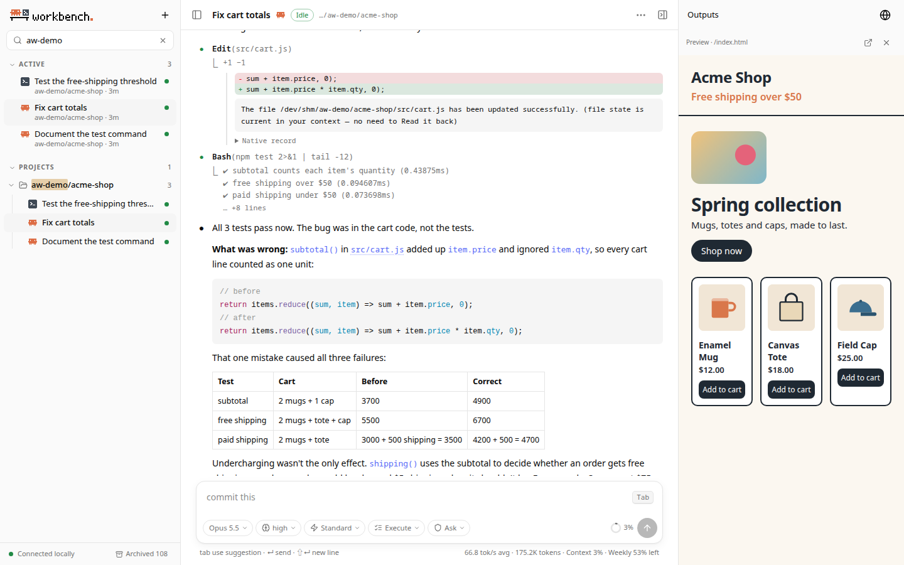

# Using Agent Workbench

Open **http://agent.localhost:17880** (or this machine's IP address or host name from another device on your network). The sidebar lists your sessions, the middle shows the conversation, and the right panel shows files and previews. Both side panels can be hidden, and dragged to resize.

## Sessions

The workbench works with the sessions the CLIs keep themselves. Every Claude Code and Codex session on the machine appears in the sidebar, whether it was started here or in a terminal, and the native session ID is its identity.

- **Continue anywhere.** Open a session and keep going, or continue it in a terminal: the "⋯" menu copies the resume command (`claude --resume <id>` / `codex resume <id>`). Whatever the CLI adds there shows up here.
- **Running elsewhere.** A session another client is using is shown read-only and followed live: new records appear as the CLI writes them, with the turn's elapsed time. Replies arrive in whole blocks rather than word by word, and that client's approvals cannot be answered here. Once the other client lets go, you can continue the session here.
- **Engines sleep.** Each session's agent stays running between turns. After 5 idle minutes (see `--idle`) it is put to sleep; the next message resumes the same session after a few seconds. A session with work in progress (a running tool, a pending approval, a dev server) is not put to sleep.
- **End a session** from the header menu to stop its agent and everything it started. Files and history stay.

### Starting a session

Press **+** in the sidebar (or the **+** on a project row). The conversation area turns into a new-session form:

1. Choose **Claude** or **Codex**.
2. Choose the project folder: recent projects are listed (pinned ones first), you can type to filter or type a path starting with `/` or `~` (Tab completes), or use **Browse folders…** to pick a folder in your home directory.
3. Optionally set model, effort, mode and permissions.
4. Type the first message and press Enter. The CLI creates its native session and you are switched to it.

The title comes from the first message until the CLI names the session; rename it from the "⋯" menu.

## The composer

| Key | While idle | While a turn runs |
| --- | --- | --- |
| Enter | send | **steer**: send into the running turn |
| Shift+Enter | new line | new line |
| Queue button | | keep the message for after this turn |
| Esc | | interrupt the turn |
| Tab | fill in the suggested next message (empty prompt) | |
| `/`, `$` | open the command or skill list | |

**Steering.** A message sent during a turn goes into that turn and is marked *Steered*:
- **Codex** adds it to the active turn (`turn/steer`); the model reads it at its next step.
- **Claude** takes it in at its next step, after the current tool call, without interrupting, exactly as pressing Enter in Claude Code's terminal UI does. If the turn finishes first, the message runs right after it. While it waits it shows **Send now**, Claude Code's own send-now (Ctrl+X Ctrl+S): a running tool moves to the background, or the reply in progress stops, and the message is handled at once.

Commands (`/…`) cannot steer; they run after the turn. If an approval is pending, a steered message is queued instead and the reason is shown.

**Suggested next message (Claude).** When a Claude turn ends, the empty prompt may show in grey what you would likely type next, such as "run the tests" or "commit this", as in Claude Code's terminal. Tab (or the **Tab** key cap, which also works by touch) fills it in to edit or send; Enter on the empty prompt does not send it. Claude Code makes the suggestion itself, with one more request on the cached conversation, and leaves it out when the next step isn't clear, early in a conversation, in plan mode, when rate limited, or when a request waits for you. Turn it off for all sessions in the "⋯" menu (Suggest next prompt); Claude Code's own `promptSuggestionEnabled: false` setting turns it off too. Codex sessions don't have suggestions yet.

**Queue.** Queued messages wait above the composer and are sent one after another as turns end. Each has **Steer** (send it into the running turn now; **Send now** when nothing is running) and a remove button. After an interrupt or an error the queue pauses until you continue it.

**Settings pills.** Model, effort, speed, mode and permissions sit under the input. Each shows the value in effect: your choice for this session, else what the running agent reports, else the CLI's configured default (shown muted). Changes apply from the next turn. The usage menu can save the current choices as defaults for new sessions without changing the CLI's own configuration.

**Approvals in new sessions.** Unless you saved other defaults, new sessions start with each CLI's automatic approvals: Claude Code's **Auto** mode (a reviewer model screens actions; Claude asks only when it can't decide) and Codex's **Auto-review**, the "Approve for me" of its TUI (the workspace sandbox, with requests to go beyond it reviewed by Codex's auto-review agent instead of you). Each auto-review decision appears as a line in the conversation while you watch, a denial in the warning color. If the CLI can't use automatic approvals (for Claude, a model, plan or setting that doesn't allow auto mode), the session falls back to asking you and a line in the conversation says why. Pick Ask (Claude) or Workspace (Codex) in the permissions pill to be asked every time; existing sessions keep their settings. When a Claude session that was in auto mode before planning presents its plan, the plan card offers **Yes, and use auto mode** first, as Claude Code does.

### Commands and skills

Type `/` or `$` to open a list that filters as you type (prefix matches first, aliases included). Use ↑/↓ to choose, Tab or Enter to complete, Esc to close.

- **Both agents:** `/plan [task]` and `/default [task]` switch plan mode (and send the task if given); `/model`, `/effort`, `/permissions` and `/fast` change the matching setting.
- **Claude:** the list is Claude Code's own command list (terminal-only commands left out). Commands are sent as text and run by the CLI; output of local commands such as `/context` is shown formatted. A `$skill` goes at the start of a message and is sent as `/skill`.
- **Codex:** skills come from the CLI; `$skill` can appear anywhere, several times. The Codex TUI commands that make sense here are mapped to the app-server: `/compact`, `/review [instructions]`, `/goal [<objective>|clear|edit|pause|resume]`, `/rename`, `/fork` (opens the new session), `/mcp`, `/diff`, `/quit`; `/new`, `/status`, `/usage` and `/skills` are handled by the page. Unknown commands are refused rather than sent to the model; start with `//` to send a literal `/`.

### Goals

`/goal` gives the agent a goal to keep working on across turns, as in each CLI.

- **Codex:** `/goal <objective>` sets it and Codex starts working at once, starting each next turn itself until it marks the goal complete (or stalls, or reaches a usage or token limit). `/goal` shows the objective, status, time and tokens; `/goal pause`, `/goal resume`, `/goal edit <objective>` and `/goal clear` do what they say, and `/goal edit` alone puts the current objective in the composer to edit. A new objective over an unfinished goal asks first (**Replace goal** / **Keep current**); the replaced goal's time and tokens start over.
- **Claude:** `/goal <condition>` (or `/goal clear`) runs in Claude Code: Claude keeps working in the same turn until a separate check finds the condition met. It needs hooks to be allowed (not `disableAllHooks` or `allowManagedHooksOnly`).

While a goal is set, a bar above the composer shows its status in the CLI's words (*Pursuing goal*, *Goal paused*, *Goal stalled*, *Goal achieved*; *Goal active*, *Goal met* for Claude), the objective, and time, checks and tokens; click it for the full objective and the latest check. Its buttons are **Pause**, **Resume** and **Edit** (Codex) and **Stop**, which ends the goal and also stops the turn pursuing it. When a goal ends, a line in the conversation says how, and the bar stays until you close it. A Codex engine pursuing a goal is not put to sleep between its turns.

### Background work

Work that runs outside a turn shows where you look, and can be stopped there.

- **What counts:** Claude's background tasks (shells started with `run_in_background`, monitors, background subagents, MCP tasks), Codex's background terminals (a dev server it left running), and, when the workbench runs as its systemd service, processes an agent left behind that outlived the command that started them (`nohup server &`).
- **Where it shows:** the session's row in the sidebar gets a turning ring with the count instead of the idle dot, and the header reads "Idle · 2 in background". Above the composer, a tray sums it up in one line ("2 background tasks · npm run dev 12m"); click it for one row per task with its kind, command or description, running time and progress (a subagent's tool uses, a terminal's CPU and memory). **Output** shows the end of a Claude task's output, updated while it runs; **Stop** stops one, **Stop all** all of them. Ended tasks stay with how they ended until your next message.
- **When it ends:** Claude starts a turn by itself to read the result; that turn shows as running like any other. A Codex terminal or another process that ends adds a line to the conversation.
- **Move to the background:** while Claude waits on a long command or subagent in the foreground, press **Ctrl+B** in the composer (or **⌃B background** in the status line) to move it to the background, as in Claude Code; the turn goes on.
- **Sleep:** background work keeps the engine awake. **Sleep** asks first ("Stop the background work?") and stops it with the engine; **End session** always stops everything.

### Approvals and questions

Besides tools and questions, two other requests get their own cards: Codex asking for more access than its sandbox gives (network, paths outside the workspace), answered for this turn, for the session, or not at all; and an MCP server asking for input through the agent (Claude or Codex), as a small form (choices, text, numbers, a checkbox) or a page to open, with **Submit**, **Decline** and **Cancel**.

Permission requests appear as cards in the conversation: **1** allow, **2** allow for this session, **3** deny and tell the agent what to do instead; arrow keys and Enter work too, Esc denies. Questions are answered in place. Claude's AskUserQuestion shows a card with its options (single or multiple choice) and an "Other" answer while Claude waits. Codex asks in two ways: an input request shows the same kind of card, and Codex's newer questions (`request_user_input_async`) appear in its reply as a card with the first option preselected and a box for a typed answer; Send answers puts them into the running turn, which Codex may be waiting in. A question that ended without an answer (declined, interrupted, the turn ended, or you wrote something else) stays in the conversation marked **Not answered**, with an **Answer** button: the answers then go out as your next message (Codex's own reply format for Codex, a readable "Answers to your questions" list for Claude), and the card shows them once sent. Plans end with the same choices as the agents' own terminals. Claude's plan confirmation shows the plan with **Yes, auto-accept edits**, **Yes, manually approve edits** and **No, keep planning** (with an optional note on what to change); either Yes takes the session out of plan mode with that permission setting. When a Codex plan-mode turn ends with a plan, the plan gets **Implement this plan?**: **Yes, implement this plan** switches the session to Default mode and sends "Implement the plan.", **Yes, clear context and implement** starts a new session in the same folder with the same settings in Default mode and the plan as its first message, and **No, stay in Plan mode** closes the card. Requests the workbench does not know are shown as they are, and can be denied or interrupted.

## The conversation

- Lines in the conversation also say what the CLIs only reported to their own terminals: a step Claude's auto mode blocked (on the tool's row), Claude's warnings, a switch to a fallback model, a hook that failed (except tool and Stop hooks, whose result already shows), instruction files that are too long, and a Codex hook that blocked or stopped something. A Codex turn that changed files ends with one **Changes** row (the files, +/−, and the whole diff when expanded), and a running MCP tool shows its progress message. While a turn waits on something other than the model, the status line says what: an API error being retried, auto mode checking a step, a hook running, Codex's auto-review checking a command.
- Replies are Markdown. Tool calls, thinking and subagents collapse to one line (`● Bash(npm test)`), with a short result below (`⎿ 2 failed, 31 passed`, `+3 −1`); click to expand the command, diff, full output or the raw record. **Ctrl+O** expands or collapses all.
- **Subagents.** A subagent shows as one row, `● Agent(description)`, with the tools it runs as lines under it (the latest three while folded). This works for a Claude Agent call and for a Codex subagent, whose own thread no longer mixes into the conversation. The lines are the same whether you watched the turn or opened the session later. For each subagent, the row keeps its latest 200 tool calls and counts the rest ("+N earlier tool uses not kept"). **Transcript ↗** on the row opens the subagent's own session (also nested under the parent in the sidebar); there, **Open parent** returns. A permission request from a subagent says so on its card ("From subagent · …"), with the same link.
- With the Default theme, colors follow each CLI's default terminal theme: Claude Code's for Claude sessions, Catppuccin (as the Codex TUI uses) for Codex sessions. Other themes color both agents the same way (see [Appearance](#appearance)). Code blocks with a language are highlighted; ANSI colors in tool output are kept.
- The to-do list (Claude's TodoWrite, Codex's plan) stays pinned above the composer.
- The status line shows what the turn is doing (Thinking, Running a tool, Waiting for the model, …), its elapsed time, output tokens and speed. The ring next to it is context usage; the line below opens usage details and quota windows.
- History loads newest first; scroll to the top for older messages.

## Files and previews

- **Paths in replies** are links. A relative path is resolved from the directory the agent was in when it wrote it, then from the session's launch directory and the subprojects it worked in. Only files inside the launch directory open.
- **Images and videos** open in a viewer: zoom with the wheel or a pinch, drag to pan, double-click to switch between fit and 1:1 (`+`, `-`, `0`, `1`), and use ←/→ for the other media in the same message or folder. Videos stream with seeking.
- **HTML, PDF and SVG** open in the right panel, on an isolated preview origin.
- **Dev servers:** the globe button in the right panel attaches an existing loopback URL, or starts a command you enter on a fixed port, for example `npm run dev -- --host 127.0.0.1 --port 5173 --strictPort`. A server the workbench started stops with the session. Loopback URLs in replies open in the panel too.
- **Show in Files** reveals a file in the desktop file manager of the computer running the workbench.

HTML and dev-server previews use `p-*.agent.localhost` addresses in a browser on the machine running the workbench. On other devices, files open sandboxed from the workbench's own address instead (see [Access from other devices](#access-from-other-devices)); dev servers only open on the workbench computer.

## The sidebar

- **Agent icons:** the coral burst is Claude, the `>_` tile is Codex. At the right end of each row: a spinner while running, a hand while waiting for approval, a monitor when another client is using it, a triangle on error, a dot while the engine is loaded, otherwise the time of the last activity.
- **Sessions that need you** (an approval, a question, a plan to decide on, including Codex's async questions and "Implement this plan?") get a filled bell badge and a highlighted row, come first under **Active** even while their engine sleeps, and the Active header counts them ("2 need you"). The tab title shows the count, as in "(2) Agent Workbench"; on narrow screens a dot on the sessions button points to them while the sidebar is closed.
- **Desktop notifications** announce a session that starts needing you while the page is in the background. Turn them on or off per browser in the "⋯" menu (Desktop notifications); turning them on asks the browser for permission. They need https or localhost.
- **Active** lists sessions that are running, waiting, loaded or in use elsewhere. **Pinned** keeps the sessions you pin, in pin order.
- **Projects** groups sessions by the directory they were started in (moving elsewhere inside the session doesn't change that), nests subdirectories, and folds shared path prefixes into one folder. A session that worked across several subprojects shows them on a second line (`↗ api, web`) and is listed under each of them as related.
- **Other** holds sessions that are not project work: `codex exec` runs, temporary directories, and chats from the home directory or the Codex app.
- **Search** (press `/`) matches titles, projects and agents; separate words with spaces.
- **Hover a row** (or focus it with the keyboard) to show its pin button and "⋯" menu: rename, copy the resume command, copy the session ID, and
  - **Codex:** Archive / Unarchive and Delete. Both use Codex's own thread operations, so the Codex app and CLI see the same change. Delete asks first and is permanent. Archived sessions open read-only with an Unarchive button; **Archived N** at the bottom shows them.
  - **Claude:** Claude Code has no archive or delete for local sessions, so the menu offers **Hide from sidebar**, which never touches its records. **Hidden N** at the bottom shows hidden sessions.

Pins, hidden sessions and display names are stored by the workbench and sync live between browsers.

## Access from other devices

The workbench listens on all interfaces by default (`0.0.0.0:17880`) and `start` prints its LAN addresses. **Only this computer uses it without signing in**: a browser on this machine opening `localhost`, `agent.localhost` or `127.0.0.1` (or `[::1]`). Every other device, and every other address (this machine's LAN IP or host name too), follows the choice in **⋯ → Settings → Access & security → Access from other devices**:

| Choice | Other devices |
| --- | --- |
| **Off** (default) | are refused with a page that says how to turn access on |
| **Pairing code** | open the page and enter the code shown in Settings; the browser then stays signed in until the workbench restarts, up to 12 hours |
| **Password** | sign in with a username and password in the browser's own prompt (HTTP Basic), which browsers can remember. The first time, Settings fills in the username `workbench` and a generated password; edit either, or generate a new password, and save |

- Any signed-in device can change this setting. Saving warns when the change disconnects the device you are on, or makes it sign in again.
- A card at the top of the tab says how the page you are on is connected: this computer or another device, and how it signed in; whether the connection is encrypted (HTTPS) or plain HTTP across the network; whether this address may make changes; and the access choice saved. With a pairing code, **Signed-in devices** counts the devices signed in, and **Sign out other devices** ends every sign-in but yours. With a password, browsers keep it, so a new password signs every device out.
- The pairing code and the password are kept in the data directory, readable only by you, and survive restarts. Settings shows them, with copy buttons.
- Ten wrong codes or passwords from one address within a minute block that address for a minute; other devices are not affected.
- The workbench speaks plain HTTP, so on your network the password and the session travel unencrypted. On networks you don't trust, use a VPN such as Tailscale.
- **Allowed origins.** Changes (sending messages, pins, Settings, signing in with the code) are only accepted from a page on the same address the request names, over `http://`. When you open the workbench through an HTTPS tunnel or reverse proxy, for example a Cloudflare Tunnel at `https://ai.example.com`, the browser reports that address instead, so add it under **Allowed origins** in Settings (shown while access from other devices is on), from the workbench computer or a device that already works. Until then pages and history load there but every change is refused, with a message saying what to add. List only addresses that lead to this workbench: pages there may make changes once signed in. This computer, while it skips sign-in, never takes changes from them.
- **Previews on other devices and through tunnels.** On the workbench computer at `agent.localhost`, previews open on their own `p-*.agent.localhost` addresses as always. Everywhere else, files (HTML, PDF, SVG, text) open from the workbench's own address instead, sandboxed: the page runs in an origin of its own and cannot reach the workbench, its cookies or the page around it. Links in an HTML file that start with `/` don't resolve there (relative ones do), a PDF shows in the browser's own viewer, and the button above the preview opens it in a new tab. Dev-server previews still only open on the workbench computer. Each opened file gets a link that only works for the sign-in that opened it: until that sign-in ends or its rules change, the preview closes, 12 hours pass, or the workbench restarts.
- **Tunnels and reverse proxies on this machine.** Whatever they relay connects from this computer, so it needs care:
  - Requests that carry proxy headers (`X-Forwarded-For`, `Forwarded`, `Via`, `X-Real-IP`, `CF-Connecting-IP` and similar, which nginx, Caddy, Apache, cloudflared or ngrok usually add) are treated as other devices and sign in.
  - Plain TCP tunnels (`ssh -R`, frp, ngrok TCP, socat) and proxies that add no such header still look like this computer, and their visitors can claim `Host: localhost`. Before exposing the workbench that way, turn on **Sign in on this computer too** in Settings: then this computer signs in with the pairing code or password as well. It needs one of them, and Off cannot be chosen while it is on. If you lose the code or password, they are in the data directory (`pairing-code`, `access-password.json`).
  - SSH port forwarding into this machine (`ssh -L`) arrives as this computer, which is fine: SSH already signed you in.
- From public internet addresses only `agent.localhost:PORT` is accepted, and it signs in like any other device.

`--listen 127.0.0.1:17880` keeps the workbench to this machine altogether.

## Settings

**⋯ → Settings** has three tabs:

- **General:** appearance, desktop notifications and suggested next prompts. These are the same controls as the **⋯** menu, and they apply at once.
- **Access & security:** how this page is connected, which devices may sign in and how, allowed origins, and signed-in devices (see [Access from other devices](#access-from-other-devices)). Saved with its button. Unsaved changes are marked on the tab and kept while you switch tabs. Closing asks before discarding them.
- **About:**
  - This workbench: version with its release notes, web build, how long it has run, whether engines run as systemd units or child processes, platform and Go version, listen address, data directory, start at login.
  - Each CLI: version, path, and for Claude Code the optional features the workbench uses that this version has.
  - Local data: size, how long live events are kept, the number of sessions.
  - **Check for updates** asks GitHub for the latest release, only when you click it. The workbench makes the request, without anything about you or this machine.
  - **Copy diagnostics** copies the same facts as `agent-workbench doctor`, for a bug report.

The tab you used last opens next time, per browser.

## Appearance

The header's **⋯** menu sets the **Mode** (System, Light or Dark) and the **Theme**. Every theme has a light and a dark palette, so the mode works with any of them. Changes apply at once and are remembered by each browser.

| Theme | Light | Dark | Character |
| --- | --- | --- | --- |
| Default | neutral | neutral | Neutral interface; each agent keeps its own CLI's colors |
| Everforest | Light Medium | Dark Medium | Soft greens on warm paper, made to be easy on the eyes |
| Gruvbox | soft light | soft dark | Warm retro tones |
| Solarized | light | dark | Tuned contrast, the same accents in both modes |
| Paper | sepia | warm dark | For long reading, low in blue light |
| Catppuccin | Latte | Mocha | Pastels |
| Rosé Pine | Dawn | Moon | Muted rose and pine |
| Nord | Snow Storm | Polar Night | Arctic blue-grey |
| Tokyo Night | Day | Storm | Deep blue |

A theme other than Default colors the whole page, and both agents the same way: the interface, headings, links, inline code, code highlighting and the ANSI colors in tool output. The colors come from each project's published palette. Where an accent was too faint to read on its background (yellows on light backgrounds, Nord's accents in light mode), only its lightness was changed, keeping the hue.

The interface adapts to phones: the sidebar and the right panel slide over the conversation.
